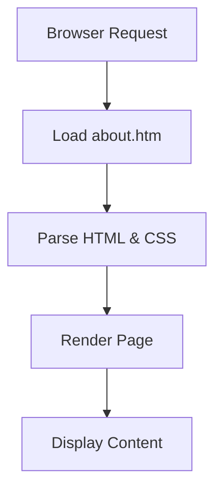

# Architecture

_Generated by Forge from `main` at `c2d7679`._

Perfect! Now I have a clear understanding of the project. Let me write the Architecture page:

---

## Architecture

This project is a minimal HTML-based web application designed to demonstrate version control workflows and collaboration practices. The architecture is straightforward, consisting of static HTML files with embedded styling that can be served directly in any web browser without requiring a backend server or build process.

## Project Structure

The repository contains two main files:

| File | Purpose |
|------|---------|
| `about.htm` | Main web page with "About Us" content and styling |
| `README.md` | Project documentation and overview |

## Component Overview

### HTML Page (`about.htm`)

The `about.htm` file serves as the primary deliverable, containing:

- **HTML Structure**: A semantic document with proper DOCTYPE, meta tags for charset and viewport configuration
- **Embedded CSS**: Internal stylesheet defining the visual presentation
- **Content Sections**: Multiple sections including a header, mission statement, description, and call-to-action

The page uses a centered container layout with a maximum width of 800px, white background, and subtle shadow effects for visual hierarchy.

### Styling Approach

The styling is self-contained within the HTML file using a `<style>` block:

```html
<style>
    body {
        font-family: Arial, sans-serif;
        line-height: 1.6;
        background-color: #f4f4f4;
    }
    .container {
        max-width: 800px;
        margin: 0 auto;
        background-color: white;
        padding: 30px;
        border-radius: 5px;
        box-shadow: 0 0 10px rgba(0,0,0,0.1);
    }
</style>
```

This approach ensures the page is self-contained and requires no external dependencies.

## Data Flow



## Key Features

- **No Backend Required**: Static HTML files can be opened directly or served via any web server
- **Responsive Design**: Viewport meta tag enables proper rendering on mobile devices
- **Self-Contained**: All styling is embedded; no external CSS files needed
- **Semantic HTML**: Proper document structure with DOCTYPE and language attributes

## Sources
- `about.htm`
- `README.md`
