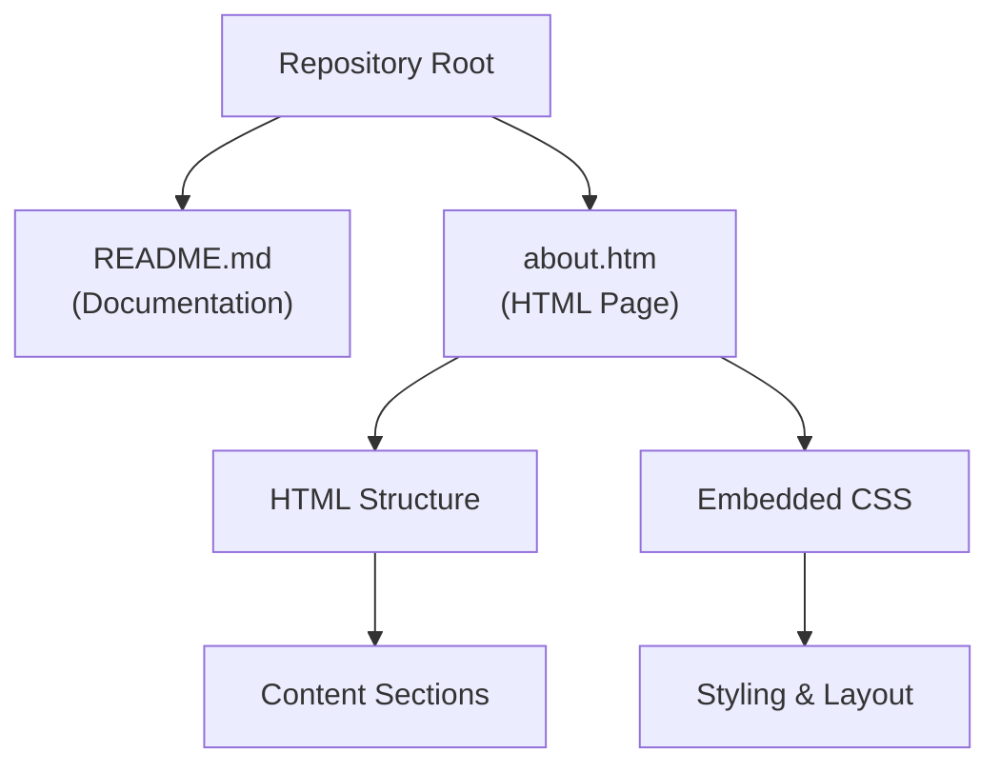

# Architecture

_Generated by Forge from `main` at `c2d7679`._

Perfect! Now I have all the information I need. Let me write the Architecture page based on the repository structure.

---

# Architecture

This is a simple HTML-based project with a minimal, flat directory structure. The repository contains static HTML files and documentation, designed to demonstrate version control workflows and best practices without complex build systems or dependencies.

## Project Structure

The repository follows a straightforward layout with all files at the root level:

| File | Purpose |
|------|---------|
| `README.md` | Project overview and description |
| `about.htm` | Main HTML page with "About Us" content |

## File Organization

**`README.md`** — The project entry point that provides a brief description of the repository as "a simple repository with an HTML file displaying Hello World."

**`about.htm`** — A self-contained HTML file that serves as the primary web page. It includes:
- Embedded CSS styling for layout and presentation
- Responsive design with a centered container
- Multiple sections: "About Us", "Our Mission", "What We Do", and "Get Started"
- Meta tags for character encoding and viewport configuration

## Architecture Diagram

## Design Approach

The project uses a **static HTML approach** with no build tools, frameworks, or external dependencies. All styling is embedded within the HTML file using `<style>` tags, making each file completely self-contained and portable. This design is ideal for:

- Learning version control fundamentals
- Demonstrating collaboration workflows
- Serving as a template for simple web projects
- Easy deployment without compilation steps

## Sources
- `README.md`
- `about.htm`
